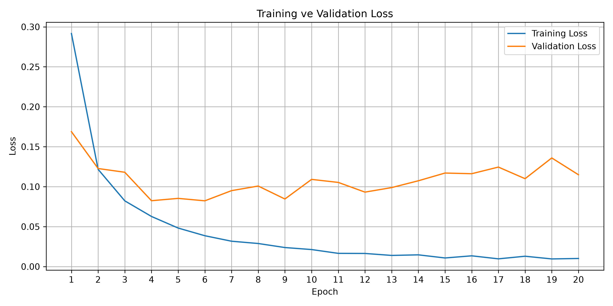
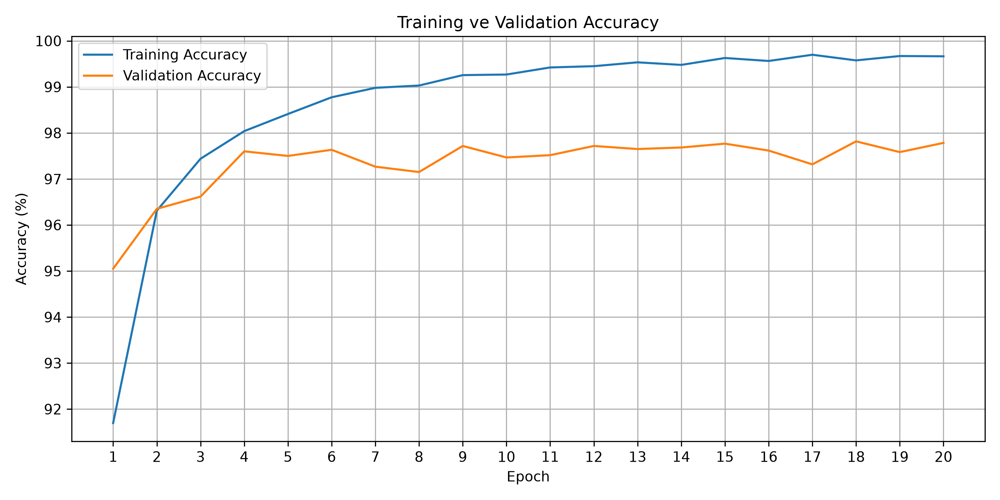
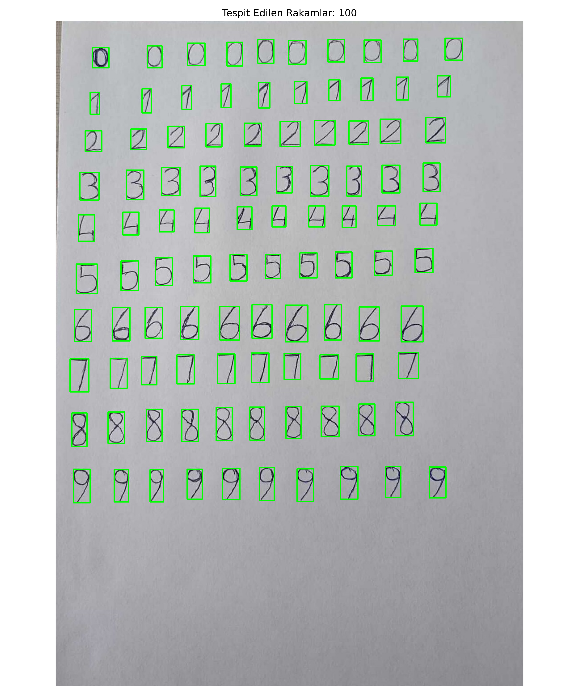
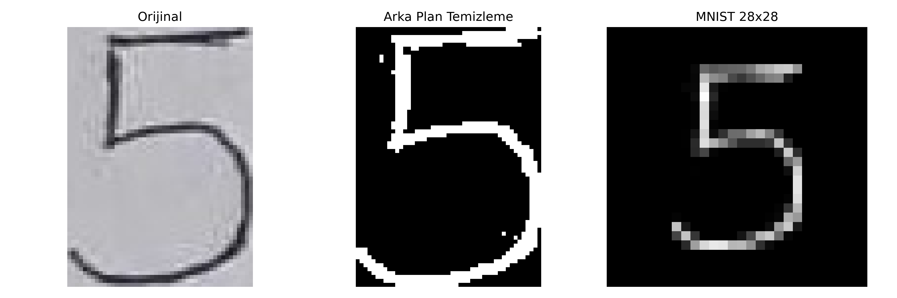
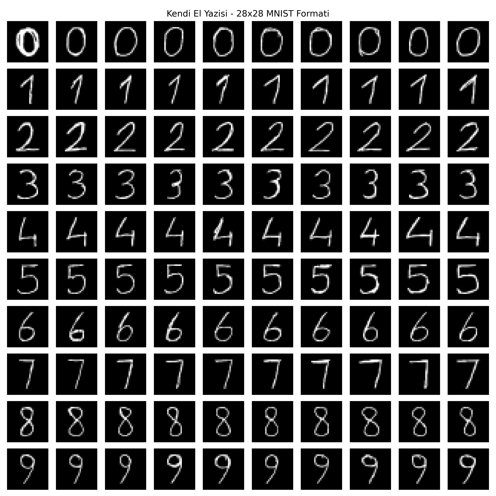
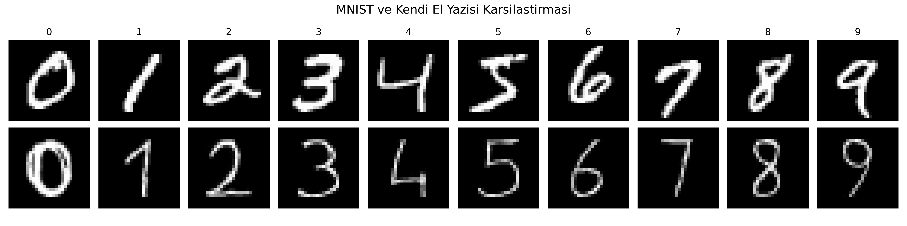
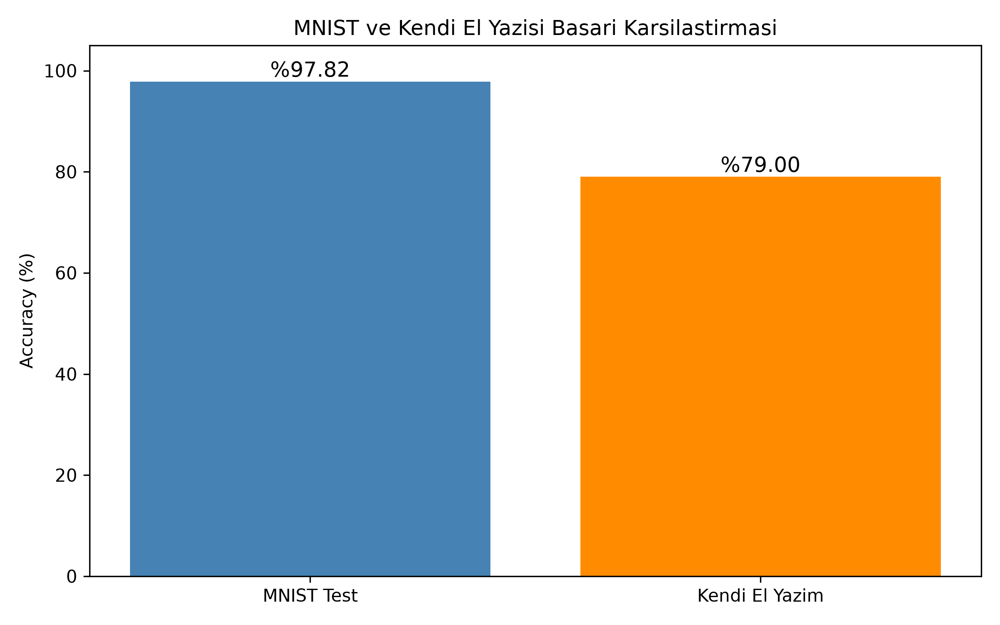
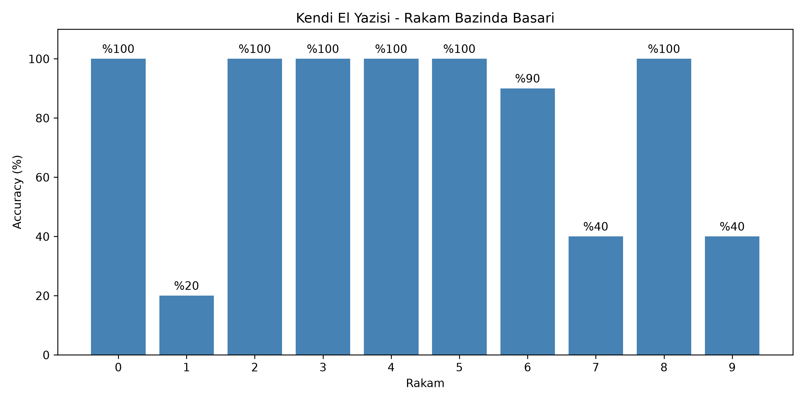
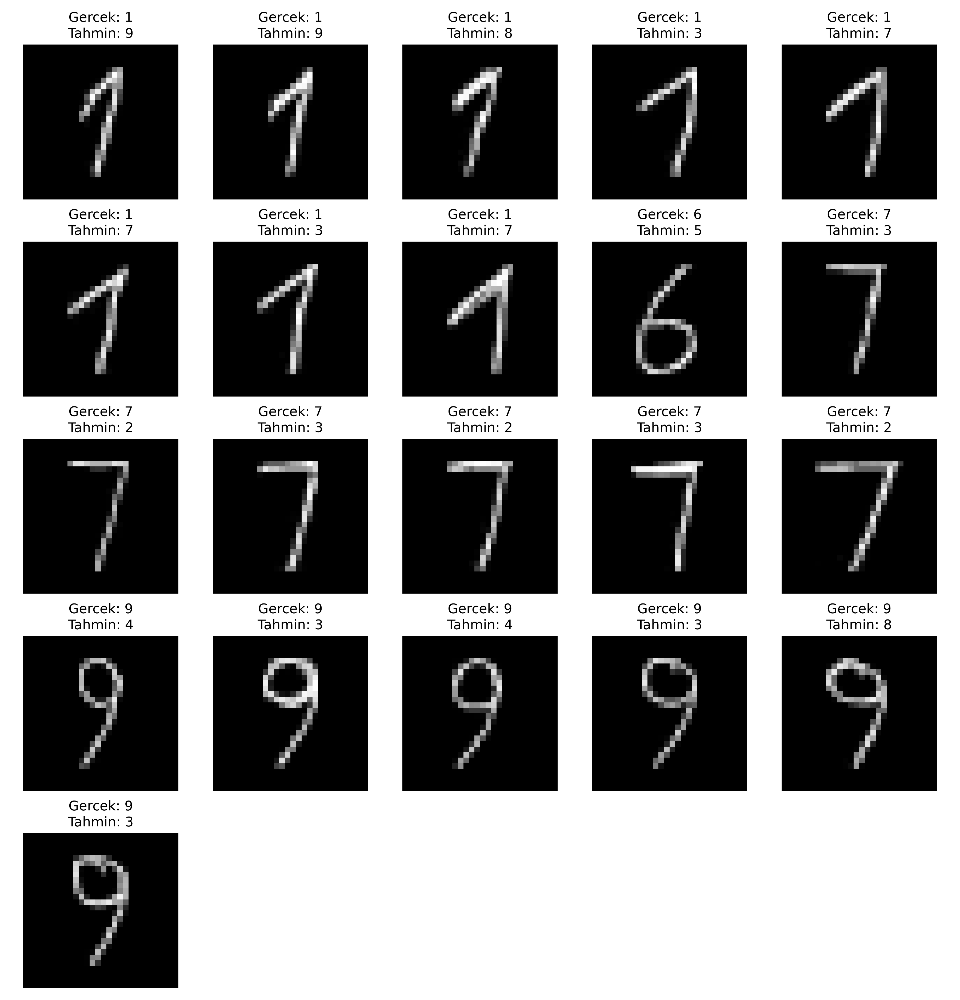

# MNIST Veri Seti ile El Yazısı Karşılaştırması MLP Modeli

## 1. Projenin Amacı

Bu projede, MNIST veri seti kullanılarak el yazısı rakamlarını sınıflandırabilen bir **Multi-Layer Perceptron (MLP)** modeli PyTorch ile sıfırdan geliştirilmiştir.

Çalışma iki temel aşamadan oluşmaktadır:

1. MNIST veri setiyle MLP modelinin eğitilmesi ve performansının değerlendirilmesi.
2. Kendi el yazımızla oluşturduğumuz 100 rakamlık veri kümesinin görüntü işleme teknikleriyle hazırlanarak eğitilmiş model üzerinde test edilmesi.

## 2. Veri Seti ve Veri Hazırlama

MNIST, 0–9 arasındaki rakamları içeren 70.000 adet 28×28 piksel boyutunda gri tonlamalı görüntüden oluşmaktadır.

Veri kümesi şu şekilde ayrılmıştır:

| Veri Kümesi | Görüntü Sayısı |
|---|---:|
| Training | 54.000 |
| Validation | 6.000 |
| Test | 10.000 |

Verilerin eğitim ve doğrulama kümelerine ayrılmasında `random seed = 42` kullanılmıştır.

Görüntüler `transforms.ToTensor()` kullanılarak [0,1] aralığına normalize edilmiştir.

Test kümesi eğitim ve model seçimi sırasında kullanılmamıştır.

## 3. MLP Model Mimarisi

Model PyTorch'un `nn.Module` sınıfı kullanılarak oluşturulmuştur.

| Katman | Nöron Sayısı | Aktivasyon |
|---|---:|---|
| Input | 784 | — |
| Hidden Layer 1 | 128 | ReLU |
| Hidden Layer 2 | 64 | ReLU |
| Output | 10 | — |

**Toplam öğrenilebilir parametre sayısı: 109.386**

28×28 boyutundaki görüntüler `Flatten` işlemiyle 784 elemanlı vektörlere dönüştürülmüştür.

Çıkış katmanında 10 sınıf için skorlar üretilmiştir. Kayıp fonksiyonu olarak `CrossEntropyLoss` kullanıldığından çıkış katmanına ayrıca Softmax eklenmemiştir.

## 4. Hiperparametreler

| Hiperparametre | Değer |
|---|---|
| Framework | PyTorch |
| Optimizer | Adam |
| Learning Rate | 0.001 |
| Loss Function | CrossEntropyLoss |
| Batch Size | 32 |
| Epoch | 20 |
| Hidden Layers | 2 |
| Activation | ReLU |
| Random Seed | 42 |

## 5. Eğitim Süreci ve Sonuçları

Model 20 epoch boyunca eğitilmiştir. Her epoch sonunda training loss, validation loss, training accuracy ve validation accuracy değerleri hesaplanmıştır.

### Loss Grafiği

### Accuracy Grafiği

Eğitim sırasında training loss azalmaya devam ederken validation loss değerinin 6. epoch sonrasında genel olarak artmaya başladığı gözlemlenmiştir. Bu durum overfitting belirtisi olarak değerlendirilmiştir.

En düşük validation loss değerine sahip modelin ağırlıkları kaydedilmiştir.

### MNIST Test Sonuçları

| Metrik | Sonuç |
|---|---|
| Toplam Eğitim Süresi | Yaklaşık 5 dakika 30 saniye |
| En İyi Epoch | 6 |
| Test Loss | 0.0726 |
| Test Accuracy | **%97.82** |
| Doğru Tahmin | 9.782 / 10.000 |

## 6. Kendi El Yazısı Görüntülerinin Hazırlanması

Modelin MNIST dışındaki görüntülerdeki başarısını değerlendirmek amacıyla beyaz kâğıda her rakamdan 10 örnek olacak şekilde toplam 100 el yazısı rakamı yazılmıştır.

Fotoğraf OpenCV kullanılarak işlenmiştir.

Uygulanan işlemler:

1. Görüntünün gri tonlamaya dönüştürülmesi.
2. Arka planın temizlenmesi.
3. Binary maske oluşturulması.
4. Bağlı bileşen analiziyle rakamların ayrılması.
5. En-boy oranı korunarak rakamların yeniden boyutlandırılması.
6. Rakamların 28×28 siyah arka plan üzerine yerleştirilmesi.
7. Piksel değerlerinin [0,1] aralığına normalize edilmesi.

### Rakamların Tespit Edilmesi

### Görüntü Ön İşleme Örneği

### 100 Adet İşlenmiş El Yazısı Görüntüsü

## 7. MNIST ve Kendi El Yazısı Karşılaştırması

Aşağıdaki görselde MNIST görüntüleri ile kendi el yazımızdan elde edilen 28×28 görüntüler karşılaştırılmıştır.

Eğitilmiş model değiştirilmeden kendi el yazısı görüntülerinde test edilmiştir.

### Başarım Karşılaştırması

| Veri Kümesi | Accuracy |
|---|---:|
| MNIST Test | **%97.82** |
| Kendi El Yazısı | **%79.00** |

### Rakam Bazında Başarım

| Rakam | Doğru / Toplam | Accuracy |
|---|---|---:|
| 0 | 10/10 | %100 |
| 1 | 2/10 | %20 |
| 2 | 10/10 | %100 |
| 3 | 10/10 | %100 |
| 4 | 10/10 | %100 |
| 5 | 10/10 | %100 |
| 6 | 9/10 | %90 |
| 7 | 4/10 | %40 |
| 8 | 10/10 | %100 |
| 9 | 4/10 | %40 |

### Yanlış Tahmin Edilen Görüntüler

## 8. Sonuç ve Değerlendirme

PyTorch kullanılarak sıfırdan geliştirilen iki gizli katmanlı MLP modeli, MNIST test kümesinde **%97.82** doğruluk elde etmiştir.

Kendi el yazımızdan oluşturulan 100 görüntü üzerinde ise **%79.00** doğruluk sağlanmıştır.

İki veri kümesi arasındaki 18.82 yüzde puanlık fark, modelin farklı el yazısı biçimlerinden ve görüntü özelliklerinden etkilenebildiğini göstermektedir.

Özellikle 1, 7 ve 9 rakamlarının sınıflandırılmasında daha fazla hata meydana gelmiştir. Bunun olası nedenleri arasında rakamların yazılış biçimleri, çizgi kalınlıkları ve ön işleme sırasında oluşan farklılıklar bulunmaktadır.

Sonuç olarak temel MLP mimarisinin MNIST veri setinde başarılı sonuçlar verdiği, ancak farklı el yazısı görüntülerindeki genelleme performansının daha düşük olabildiği gözlemlenmiştir.

## 9. Kullanılan Teknolojiler

- Python
- PyTorch
- Torchvision
- OpenCV
- NumPy
- Matplotlib
- Jupyter Notebook (Vs Code)

## 10. Projenin Çalıştırılması

Gerekli paketleri yüklemek için:

`pip install -r requirements.txt`

Notebook dosyaları:

- `veri.ipynb` — MNIST modelinin sıfırdan eğitilmesi, grafikler ve test değerlendirmesi.
- `el_yazisi.ipynb` — Kendi el yazısı görüntülerinin işlenmesi ve eğitilmiş modelle test edilmesi.

İkinci notebook, eğitim sonucunda elde edilen `best_mlp.pth` dosyasını ve `el_yazisi.jpg` fotoğrafını kullanmaktadır.
